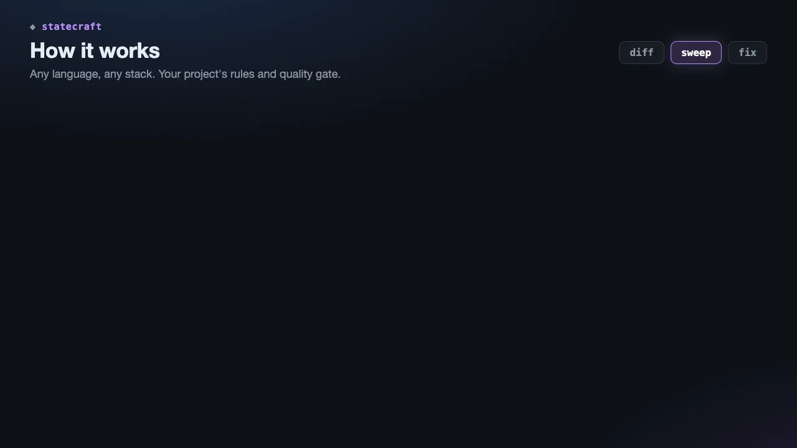
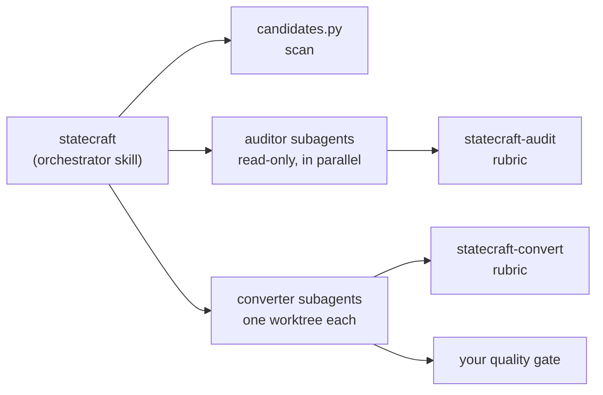
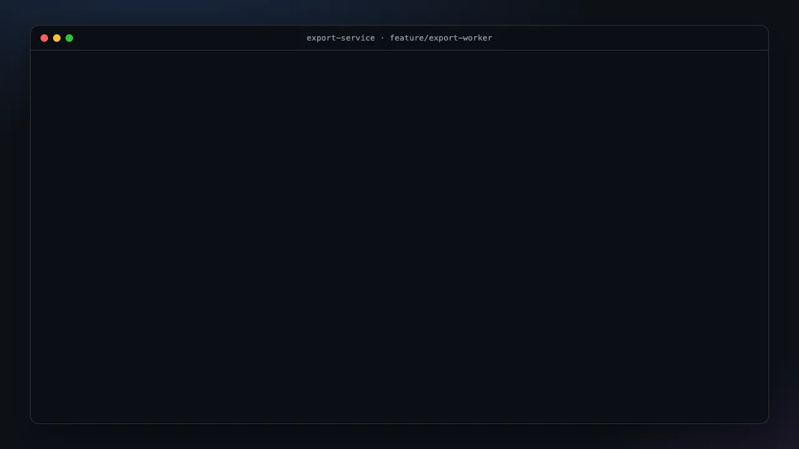

# Statecraft

**Find the state machines your code is hiding, and make them explicit without breaking anything.**

A Claude Code plugin. It works on any language and stack, and is aimed mostly at backends: services, workers, queues,
databases and integrations.

<p align="center">
  
</p>

## The problem

Most lifecycles are never written down as one. An export job "is processing" when `is_processing = 1`, "is done"
when `finished_at` is set, and "has failed" when `failed_at` is set. A UI request "is loading" when `isLoading` is
true, `error` is null and `task` is set. Each flag made sense on the day it was added.

The database and the compiler will store every combination of those flags, including the ones that mean nothing:
done *and* failed, or processing with no worker. Under retries, concurrency and crashes, the code reaches them. Users
see this as:

- a job that is never retried
- a request that is lost because it arrived while the work was busy
- an email sent twice
- a status that says "failed" for something that worked
- a spinner that never stops

Statecraft finds these **implicit state machines**, proves which invalid states can actually be reached, and converts
them into one explicit state with a single owner for its transitions, tests for every path, and the same public
contract as before.

## What it looks for

| Where | What it looks like |
| --- | --- |
| Objects in memory | `isLoading` + `error` + `task`; `busy`/`pending`/`inFlight` guards; `attempts` counters; mode strings |
| Persisted rows | `status` strings compared in ten files; `processed_at` / `failed_at` / `locked_at` acting as states; `is_paid`, `error_message` |
| Jobs and queues | `locked_by` with no lease expiry; sweepers selecting "stuck" rows; retries that depend on several columns |
| Workflows across services | sagas and webhooks whose progress is inferred from which events arrived, or from `stripe_charge_id IS NOT NULL` |
| Connections, auth, clients | connected/reconnecting flags, hand-rolled circuit breakers, MFA and invite flows, `useState` clusters |

For each machine it names the real states, maps every transition (failures, timeouts, crashes and requests that
arrive while busy included), and traces a concrete path to each invalid state before reporting it.

## Install

At the prompt of a Claude Code session:

```text
/plugin install statecraft --marketplace rolottr/claude-plugin-statecraft
```

Or from a shell:

```bash
claude plugin install statecraft --marketplace rolottr/claude-plugin-statecraft
```

Requirements: Claude Code with plugin support, `git`, and `python3` for the candidate scan (standard library only).

## Use

Ask in your own words; Claude picks the mode.

| You ask | Mode | What happens |
| --- | --- | --- |
| "statecraft this branch" | **diff** | One auditor reviews your branch's diff for new or extended implicit state, or for code that bypasses an existing explicit machine. Report only. Use it before you push. |
| "find all the implicit state machines in this service" | **sweep** | A quick scan ranks files, read-only auditors cover one module each in parallel, and the findings are merged, re-checked and ranked. Report only, then it offers to convert. |
| "statecraft and fix them" | **fix** | One converter per machine, each in its own git worktree, behind your project's quality gate. Branches are merged one at a time, with the gate run after each. |

## How it works

<p align="center">
  
</p>

Statecraft is built the way [Thermos](https://github.com/cursor/plugins/tree/main/thermos) is. The rubrics live in
skills, thin subagents load them, and an orchestrator runs the subagents in parallel and merges their results.



| Component | Role |
| --- | --- |
| [`skills/statecraft`](skills/statecraft/SKILL.md) | The orchestrator. Gathers your conventions, picks the mode, shards the codebase, merges and verifies findings, runs the converters and merges their branches. |
| [`skills/statecraft-audit`](skills/statecraft-audit/SKILL.md) | The audit rubric: where implicit state hides, what is and isn't a finding, reachability analysis, severity, and a fixed output shape for merging. |
| [`skills/statecraft-convert`](skills/statecraft-convert/SKILL.md) | The conversion rubric: idioms per language, one owner for transitions, a policy for requests made while busy, guards against stale completions, atomic persisted transitions, expand/contract migrations, stable contracts, tests and the gate. |
| [`agents/statecraft-auditor-subagent`](agents/statecraft-auditor-subagent.md) | Audits a diff or one shard. Read-only. |
| [`agents/statecraft-converter-subagent`](agents/statecraft-converter-subagent.md) | Converts the machines it is given, runs the gate, and commits on its own worktree branch. |
| [`skills/statecraft/scripts/candidates.py`](skills/statecraft/scripts/candidates.py) | A heuristic that ranks files by lifecycle-like identifiers and lists status values compared across many files. |

## A real run

<p align="center">
  
</p>

<p align="center"><sub>A replay of a real fix-mode run on <a href="examples/export-service">the example service</a>, with the waits cut. The run took 8 minutes and cost $2.18. The test suite went from 1 test to 22.</sub></p>

What the converter produced:

- **The state:** one `state` column (`queued`, `processing`, `retry_wait`, `done`, `failed`), with `CHECK`
  constraints tying each state to the data it needs.
- **Transitions:** all written in one module, each as a guarded `UPDATE … WHERE state = ?` whose affected row count
  is checked.
- **Claiming:** a worker takes a job with an atomic claim and a lease that expires, so a crashed worker's job is
  picked up again.
- **The email:** tracked separately, so a mailer error no longer turns a finished export into a failed one.
- **The API:** `export_status` returns exactly the same shape as before.

It ended with a list of decisions it would not make alone: what to show callers while a retry waits, how to migrate
existing rows, how long the lease should be, and backoff.

## Try it in a minute

```bash
git clone https://github.com/rolottr/claude-plugin-statecraft
claude-plugin-statecraft/examples/export-service/make-repo.sh /tmp/export-service
cd /tmp/export-service && claude
```

Then ask `statecraft this branch` for a report, or `statecraft: fix this branch` to watch it convert.

## What it will and won't do

- **It follows your project.** It reads `AGENTS.md`, `CLAUDE.md`, `CONTRIBUTING.md` and the explicit state types your
  code already has, and copies their shape. Write your project's rule for lifecycles and your quality-gate command
  there, and Statecraft will follow both.
- **Behaviour is preserved, except the bugs.** Each bug it fixes is listed with the scenario that caused it. When it
  can't tell a bug from intended behaviour, it keeps the behaviour and asks.
- **Contracts stay stable.** APIs, events, shared tables and SDK types keep their shape; the old fields are derived
  from the new state. Changing a contract is reported as a decision for you, never made silently.
- **Persisted state is changed safely.** Schema changes use expand/contract migrations: add the new column, backfill
  it with an explicit mapping of every old combination, and drop the old columns only in a later release.
  Transitions become compare-and-set updates.
- **Your gate stays green.** Converters run your build, tests and linters, and never weaken them to get a pass.
- **It never pushes, deploys, or runs migrations against anything but a local or test database.** Audits are
  read-only.

## Candidate scan

The sweep starts from a quick heuristic you can also run on its own:

```bash
python3 -I skills/statecraft/scripts/candidates.py path/to/repo --top 40
```

```text
$ python3 -I candidates.py kubernetes/pkg/controller --top 3
# 68 files with lifecycle signals; showing top 3
   8  garbagecollector/graph_builder.go
      identifiers: running:101, HasSynced:364, IsSynced:371, wasBlocked:662
   8  statefulset/stateful_set_control.go
      identifiers: isStale:440, isPending:456, pending:458, Running:477
   6  cronjob/cronjob_controllerv2.go
      identifiers: HasSynced:112, running:606, isFinished:716
```

It skips tests, vendored, generated and minified code, and runs in a second or two on large repositories. It points
the auditors at places to look; it does not decide what counts as a finding.

## Regenerating the animations

The animations are HTML pages in [`assets/src`](assets/src), each with a `render(t)` function. To regenerate one,
for example `problem`:

```bash
cd assets/src && npm i --no-save playwright-core && node render.mjs problem
```

This needs Google Chrome and `img2webp` from libwebp (`brew install webp`).

## License

MIT
