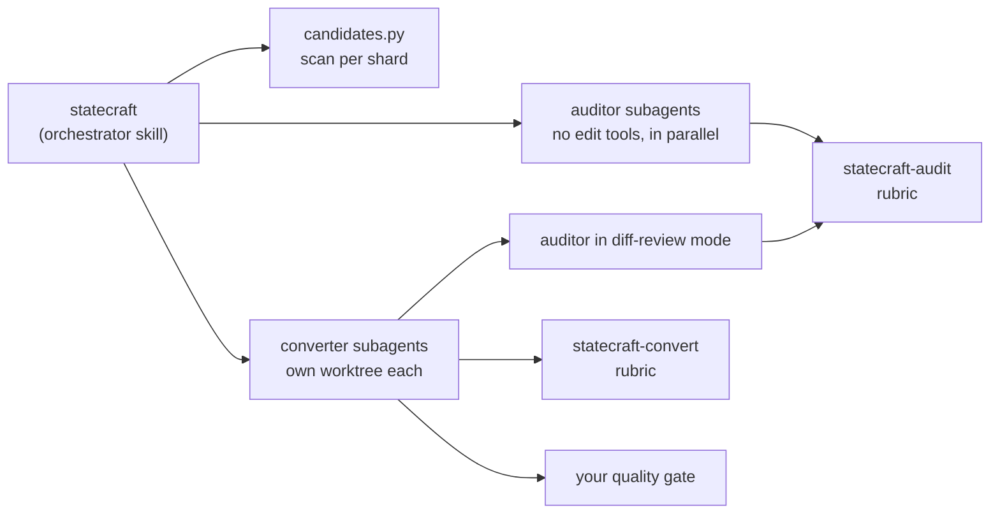

# Statecraft

**Find the state machines your code is hiding, and make them explicit without breaking anything.**

A Claude Code plugin. It works on any language and stack, and is aimed mostly at backends: services, workers, queues,
databases and integrations.

<p align="center">
  
</p>

## The problem

Most lifecycles are never written down as one. An export job "is processing" when `is_processing = 1`, "is done"
when `finished_at` is set, and "has failed" when `failed_at` is set. A UI request "is loading" when `isLoading` is
true, `error` is null and `task` is set. Each flag made sense on the day it was added.

The database and the compiler will store every combination of those flags, including the ones that mean nothing:
done *and* failed, or processing with no worker. Under retries, concurrency and crashes, the code reaches them. Users
see this as:

- a job that is never retried
- a request that is lost because it arrived while the work was busy
- an email sent twice
- a status that says "failed" for something that worked
- a spinner that never stops

Statecraft finds these **implicit state machines** and traces a concrete path to each invalid state, checking what
serialises it (transactions, locks, constraints). Then it converts them: first it pins today's behaviour with tests,
then it puts one explicit state behind a single owner for its transitions, keeping the same public contract.

## What it looks for

| Where | What it looks like |
| --- | --- |
| Objects in memory | `isLoading` + `error` + `task`; `busy`/`pending`/`inFlight` guards; `attempts` counters; mode strings |
| Persisted rows | `status` strings compared in ten files; `processed_at` / `failed_at` / `locked_at` acting as states; `is_paid`, `error_message` |
| Jobs and queues | `locked_by` with no lease expiry; sweepers selecting "stuck" rows; retries that depend on several columns |
| Workflows across services | sagas and webhooks whose progress is inferred from which events arrived, or from `stripe_charge_id IS NOT NULL` |
| Connections, auth, clients | connected/reconnecting flags, hand-rolled circuit breakers, MFA and invite flows, `useState` clusters |

It does not report lifecycles owned by a framework that your code only reads (an informer's `HasSynced`, a query
library's `isLoading`), independent flags whose combinations are all valid, or generated code.

## Install

At the prompt of a Claude Code session:

```text
/plugin install statecraft --marketplace rolottr/claude-plugin-statecraft
```

Or from a shell:

```bash
claude plugin install statecraft --marketplace rolottr/claude-plugin-statecraft
```

Requirements: Claude Code with plugin support, `git`, and Python 3.8+ for the candidate scan (standard library only).

## Use

Ask in your own words; Claude picks the mode.

| You ask | Mode | What happens |
| --- | --- | --- |
| "statecraft this branch" | **diff** | One auditor reviews your branch's diff for new or extended implicit state, or for code that bypasses an existing explicit machine. Afterwards it reads the PR discussion, if a PR exists. Report only. Use it before you push. |
| "find all the implicit state machines in this service" | **sweep** | The repo is split into shards, a quick scan ranks each shard's files, and read-only auditors run in parallel. Findings are merged, the high ones re-checked, and the report says what was and wasn't read. Report only, then it offers to convert. |
| "statecraft: fix this branch" | **fix** | Converts the findings in the scope you named: this branch's diff, or a sweep's. Converters run in their own worktrees (at most 3 at a time), and results land on a new `statecraft/<date>` branch. |

### How fix mode keeps your code safe

- **Starts clean.** It refuses to start with uncommitted changes, and checks that your gate passes first.
- **Pins behaviour first.** Converters write tests of today's behaviour before changing anything, prove them on the
  base commit, and commit them separately; they must still pass unchanged afterwards. Each fixed bug gets a test that
  is shown to fail on the base commit.
- **Adds new behaviour only to fix a bug.** Leases, cancellation, outboxes and new states visible to callers come in
  only when they fix a bug the audit found. Anything else is listed as a proposal.
- **Keeps contracts stable.** APIs, events, shared tables and SDK types keep their shape, values and errors. Changing
  one is reported as a decision for you.
- **Migrates in two releases.** This change adds and writes the new column while still writing the old ones, and
  includes a backfill covering every old combination plus a read-only count query to run in production first.
  Validating constraints and dropping the old columns is left to a later release that you run.
- **Gets checked twice.** Every converter branch is reviewed by an independent auditor and by the orchestrator, then
  lands on the new branch only if the gate passes. Your own branch is untouched until you say yes.
- **Never** pushes, deploys, or connects to a database that isn't local.

### Worktree setup for real projects

Converters work in fresh git worktrees. A fresh worktree has no `node_modules`, `.venv` or `.env`. Converters run your
documented install command, and you can make that faster or unnecessary with Claude Code's worktree settings:

- `worktree.symlinkDirectories` (in Claude Code settings) symlinks large dependency directories from the main checkout
  into each worktree, for example `node_modules` or `.venv`.
- A `.worktreeinclude` file in the repository root lists untracked files to copy into each worktree, such as `.env`
  files that point at your local database.

Statecraft resets each converter's worktree to the commit it should start from, so it works with any
`worktree.baseRef` setting.

## How it works

<p align="center">
  
</p>

Statecraft is built the way [Thermos](https://github.com/cursor/plugins/tree/main/thermos) is. The rubrics live in
skills, thin subagents load them, and an orchestrator runs the subagents in parallel and merges their results.



| Component | Role |
| --- | --- |
| [`skills/statecraft`](skills/statecraft/SKILL.md) | The orchestrator. Gathers your conventions, picks the mode and scope, shards the codebase, merges and verifies findings, runs the converters, then reviews their branches and lands them. |
| [`skills/statecraft-audit`](skills/statecraft-audit/SKILL.md) | The audit rubric: where implicit state hides, what is and isn't a finding, reachability with serialisation and deployment checks, severity, and an output shape with a stable key and a coverage line. |
| [`skills/statecraft-convert`](skills/statecraft-convert/SKILL.md) | The conversion rubric: characterization tests first, idioms per language version, one owner for transitions, today's outcomes kept, new behaviour only for listed bugs, expand-phase migrations, stable contracts, safe test targets, and the gate. |
| [`agents/statecraft-auditor-subagent`](agents/statecraft-auditor-subagent.md) | Audits a diff, a shard, or a converter's branch. It has no edit tools. |
| [`agents/statecraft-converter-subagent`](agents/statecraft-converter-subagent.md) | Runs in its own worktree (`isolation: worktree`), resets it to the base commit, converts, runs the gate, and commits on its branch. |
| [`skills/statecraft/scripts/candidates.py`](skills/statecraft/scripts/candidates.py) | A heuristic that ranks files by their densest cluster of lifecycle signals and lists status values compared in many files. |

## A real run

<p align="center">
  
</p>

<p align="center"><sub>A replay of a real fix-mode run (v0.2) on <a href="examples/export-service">the example service</a>, with the waits cut. The run took 11 minutes and cost $4.51. The test suite went from 1 test to 44.</sub></p>

Three things in that run are the reason fix mode works the way it does:

- **The converter's worktree started on the wrong commit.** Claude Code created it from `origin/main`, which doesn't
  contain the worker being fixed. The converter's preflight noticed and reset it to the base commit before touching
  anything.
- **Behaviour was pinned before the rewrite.** The first commit adds characterization tests that pass on the old
  code. They were never changed afterwards. Each of the 8 bug tests was shown to fail on the old code.
- **The independent review caught a real problem.** The auditor, in `diff-review` mode, found that a worker running
  between the two migration steps could rebuild and re-email finished exports. The orchestrator sent the converter
  back, and the third commit made the upgrade a single atomic step.

The result landed on `statecraft/20261116-1116`; `feature/export-worker` was never touched. It ended with six
decisions for a person, among them:

- retried failures now show `"queued"` instead of `"failed"`
- old workers must be stopped before running `db.upgrade`
- the 10-minute claim must be longer than the slowest build
- exports already hit by the bugs keep their current status unless you repair them

A sweep of the same repository, which is report-only, took 1 minute and cost $0.45. It found the same lifecycle,
reproduced its bugs in memory, and treated the double-claim race as a question about how many workers you run rather
than a confirmed high-severity bug.

## Try it in a minute

```bash
git clone https://github.com/rolottr/claude-plugin-statecraft
claude-plugin-statecraft/examples/export-service/make-repo.sh /tmp/export-service
cd /tmp/export-service && claude
```

This builds a small Python service with a local `origin` remote. On `main` it has an exports table; the
`feature/export-worker` branch, which isn't pushed, adds a worker that keeps its lifecycle in flags and timestamps.
Ask `statecraft this branch` for a report, or `statecraft: fix this branch` to watch it convert.

## Candidate scan

A sweep starts from a quick scan that you can also run on its own:

```bash
python3 -I skills/statecraft/scripts/candidates.py path/to/repo --top 40
python3 -I skills/statecraft/scripts/candidates.py path/to/repo --paths services/billing --top 25
```

```text
$ python3 -I candidates.py kubernetes --top 2
# scanned 7920 source files; 465 with lifecycle signals
# skipped: 4687 test, 4472 vendored or tool directory, 1393 generated (name), 5 top-level build/, 5 generated (header)
  12  pkg/kubelet/pod_workers.go  (hotspot lines 413-442 of 1783)
      identifiers: deleted bool:413, finished bool:421, IsFinished:439, IsDeleted:441, IsStarted:442, syncedAt:384, ...
   8  pkg/printers/internalversion/printers.go  (hotspot lines 1312-1324 of 3827)
      identifiers: status string:1312, FinishedAt:1004, hasRunning:1052, Running:1078, failed bool:2360, isFailed:3370
      status values: status=complete:1314, status=failed:1316, status=terminating:1318, status=suspended:1320, ...
```

A file's score is its densest 40-line cluster of lifecycle signals:
- flags such as `isLoading`
- timestamps used as states, such as `StartedAt`
- boolean fields named after a lifecycle, such as `Paid bool`
- status fields stored as plain ints or strings
- status values compared or assigned as literals

It doesn't count enum members, constants, union types, JSX attributes, HTTP codes, or words inside strings and
comments. These are all things explicit machines look like.

The output starts with a summary of what was skipped and why. On an 8–10-core Mac it takes about 3 seconds on
Kubernetes, 6 on VS Code and 20 on LLVM. It ranks by names, so it points the auditors at places to look; it does not
decide what counts as a finding.

## Project conventions win

The rubrics read `AGENTS.md`, `CLAUDE.md`, `CONTRIBUTING.md` and the explicit state types your code already has, and
copy their shape. Put your project's rule for lifecycles, your gate and install commands, and anything off-limits
there; Statecraft follows them.

## Regenerating the animations

The animations are HTML pages in [`assets/src`](assets/src), each with a `render(t)` function. To regenerate one,
for example `problem`:

```bash
cd assets/src && npm i --no-save playwright-core && node render.mjs problem
```

This needs Google Chrome and `img2webp` from libwebp (`brew install webp`).

## License

MIT
