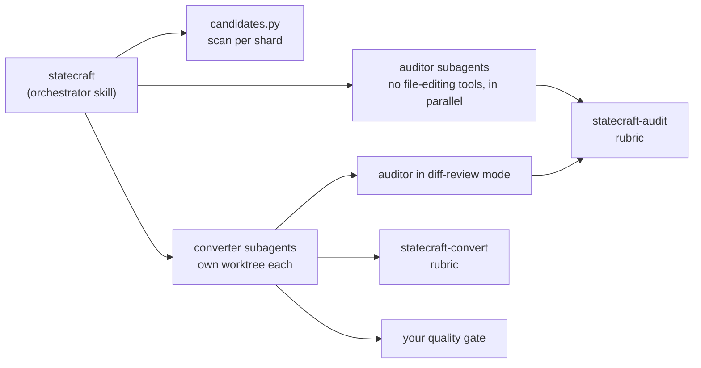

# Statecraft

**Find the state machines your code is hiding, and make them explicit without breaking anything.**

A Claude Code plugin. It works on any language and stack, and is aimed mostly at backends: services, workers, queues,
databases and integrations.

<p align="center">
  
</p>

## The problem

Most lifecycles are never written down as one. An export job "is processing" when `is_processing = 1`, "is done"
when `finished_at` is set, and "has failed" when `failed_at` is set. A UI request "is loading" when `isLoading` is
true, `error` is null and `task` is set. Each flag made sense on the day it was added.

The database and the compiler will store every combination of those flags, including the ones that mean nothing:
done *and* failed, or processing with no worker. Under retries, concurrency and crashes, the code reaches them. Users
see this as:

- a job that is never retried
- a request that is lost because it arrived while the work was busy
- an email sent twice
- a status that says "failed" for something that worked
- a spinner that never stops

Statecraft finds these **implicit state machines** and traces a concrete path to each invalid state, checking what
serialises it (transactions, locks, constraints). Then it converts them: first it pins today's behaviour with tests,
then it puts one explicit state behind a single owner for its transitions, keeping the same public contract.

## What it looks for

| Where | What it looks like |
| --- | --- |
| Objects in memory | `isLoading` + `error` + `task`; `busy`/`pending`/`inFlight` guards; `attempts` counters; mode strings |
| Persisted rows | `status` strings compared in ten files; `processed_at` / `failed_at` / `locked_at` acting as states; `is_paid`, `error_message` |
| Jobs and queues | `locked_by` with no lease expiry; sweepers selecting "stuck" rows; retries that depend on several columns |
| Workflows across services | sagas and webhooks whose progress is inferred from which events arrived, or from `stripe_charge_id IS NOT NULL` |
| Connections, auth, clients | connected/reconnecting flags, hand-rolled circuit breakers, MFA and invite flows, `useState` clusters |

It does not report lifecycles owned by a framework that your code only reads (an informer's `HasSynced`, a query
library's `isLoading`), independent flags whose combinations are all valid, or generated code.

## Install

At the prompt of a Claude Code session:

```text
/plugin install statecraft --marketplace rolottr/claude-plugin-statecraft
```

Or from a shell:

```bash
claude plugin install statecraft --marketplace rolottr/claude-plugin-statecraft
```

Requirements: Claude Code with plugin support, `git`, and Python 3.8+ for the candidate scan (standard library only).

## Use

Ask in your own words; Claude picks the mode.

| You ask | Mode | What happens |
| --- | --- | --- |
| "statecraft this branch" | **diff** | One auditor reviews your branch's diff for new or extended implicit state, or for code that bypasses an existing explicit machine. Afterwards it reads the PR discussion, if a PR exists. Report only. Use it before you push. |
| "find all the implicit state machines in this service" | **sweep** | The repo is split into shards of about 20,000 lines, a quick scan ranks each shard's files, and auditors run in parallel. Findings are merged, the high ones re-checked, and the report says what was and wasn't read. Small scopes (about 30 files) are audited directly, without subagents. Report only, then it offers to convert. |
| "statecraft: fix this branch" | **fix** | Converts the findings in the scope you named: this branch's diff, or a sweep's. First it lists every change callers will see and waits for your yes. Converters then run in their own worktrees (at most 3 at a time), and results land on a new `statecraft-<date>` branch built in a separate worktree. |

### How fix mode keeps your code safe

- **Asks before anything visible changes.** Before converting, it lists every outcome a caller or user will see change:
  responses and values, errors, emails, retries, and rollout constraints such as "stop old workers first". Bug fixes
  count too. Nothing is converted until you say yes. In a non-interactive run it stops after the plan, unless your
  request already accepts the changes the bug fixes need.
- **Never touches your checkout.** Results are landed, gated and rolled back in a separate integration worktree, so
  you can keep working while it runs. In testing, an edit made mid-run survived. At the end it offers the merge, and
  only once your working tree is clean.
- **Starts clean.** It refuses to start with uncommitted changes, and checks that your gate passes first.
- **Pins behaviour first.** Converters write tests of today's behaviour before changing anything, prove them on the
  base commit, and commit them separately; they must still pass unchanged afterwards. Each fixed bug gets a test that
  is shown to fail on the base commit.
- **Adds new behaviour only to fix a bug, and only as approved.** Leases, cancellation, outboxes and new states visible
  to callers come in only when they fix a bug the audit found and you approved the visible effect. Anything else is
  listed as a proposal.
- **Keeps contracts stable.** APIs, events, shared tables, SDK types and functions other code imports keep their
  shape, values and errors unless you approved a change.
- **Migrates in two releases.** This change adds and writes the new column while still writing the old ones, and
  includes a backfill covering every old combination plus a read-only count query to run in production first.
  Validating constraints and dropping the old columns is left to a later release that you run.
- **Gets checked twice.** Every converter branch is reviewed by an independent auditor, which lists every outcome that
  differs from the base and checks it against your approval, and by the orchestrator. Fixes are re-reviewed. A branch
  lands only if its ancestry checks out and the gate passes; a failed landing is rolled back on the integration branch
  only.
- **Never** pushes, deploys, or connects to a database that isn't local.

### Worktree setup for real projects

Converters work in fresh git worktrees. A fresh worktree has no `node_modules`, `.venv` or `.env`. Converters run your
documented install command, and you can make that faster or unnecessary with Claude Code's worktree settings:

- `worktree.symlinkDirectories` (in Claude Code settings) symlinks large dependency directories from the main checkout
  into each worktree, for example `node_modules` or `.venv`.
- A `.worktreeinclude` file in the repository root lists untracked files to copy into each worktree, such as `.env`
  files that point at your local database.

Statecraft resets each converter's worktree to the commit it should start from, so it works with any
`worktree.baseRef` setting. Worktrees live in `.claude/worktrees/`, which fix mode adds to `.git/info/exclude` (a local
file, never committed) so they don't show up in `git status`.

### What it costs

These are measured runs. Costs depend mostly on how much code the auditors and converters read.

| Run | Scope | Time | Cost |
| --- | --- | --- | --- |
| diff | the example branch (31-line worker) | 2 min | $1.63 |
| fix, stopped for approval | the example branch | 2 min | $1.56 |
| fix, approved | the example branch | 15 min | $7.30 |
| sweep, 4 shards in parallel | Spark `scheduler`, `deploy`, `storage` (193 files, 53k lines) | 11 min | $17.78 |

That Spark sweep found 33 machines, 19 of them with reachable invalid states. The orchestrator re-read the code
behind all 6 high findings and downgraded one.

### Headless and CI

In `claude -p`, the orchestrator is woken again each time a subagent finishes, so `--output-format stream-json` can
contain several `result` events. The last one is the full report.

## How it works

<p align="center">
  
</p>

Statecraft is built the way [Thermos](https://github.com/cursor/plugins/tree/main/thermos) is. The rubrics live in
skills, thin subagents load them, and an orchestrator runs the subagents in parallel and merges their results.



| Component | Role |
| --- | --- |
| [`skills/statecraft`](skills/statecraft/SKILL.md) | The orchestrator. Gathers your conventions, picks the mode and scope, shards the codebase, merges and verifies findings, runs the converters, then reviews their branches and lands them. |
| [`skills/statecraft-audit`](skills/statecraft-audit/SKILL.md) | The audit rubric: where implicit state hides, what is and isn't a finding, reachability with serialisation and deployment checks, severity, and an output shape with a stable key and a coverage line. |
| [`skills/statecraft-convert`](skills/statecraft-convert/SKILL.md) | The conversion rubric: characterization tests first, idioms per language version, one owner for transitions, today's outcomes kept, new behaviour only for listed bugs, expand-phase migrations, stable contracts, safe test targets, and the gate. |
| [`agents/statecraft-auditor-subagent`](agents/statecraft-auditor-subagent.md) | Audits a diff, a shard, or a converter's branch. It has no file-editing tools; it keeps Bash for reading, and for reproductions and test runs in temporary copies. |
| [`agents/statecraft-converter-subagent`](agents/statecraft-converter-subagent.md) | Runs in its own worktree (`isolation: worktree`), resets it to the base commit, converts, runs the gate, and commits on its branch. |
| [`skills/statecraft/scripts/candidates.py`](skills/statecraft/scripts/candidates.py) | A heuristic that ranks files by their densest cluster of lifecycle signals and lists status values compared in many files. |

## A real run

<p align="center">
  
</p>

<p align="center"><sub>A replay of a real fix-mode run (v0.3) on <a href="examples/export-service">the example service</a>, with the waits cut. It took 15 minutes and cost $7.30; the test suite went from 1 test to 45.</sub></p>

What that run shows:

- **Approval came first.** The request accepted "the visible changes the bug fixes need", and the orchestrator held the
  converter to exactly the six it listed. Where a bug fix had a choice it didn't need to make (show `"failed"` or
  `"queued"` between retries), it kept today's value and asked.
- **Your checkout was left alone while you worked.** Four minutes in, a file in the checkout was edited, as if by the
  user. Landing and gating happened in the integration worktree, so the edit survived. At the end the orchestrator
  saw the uncommitted edit and held back the merge until it is committed.
- **The converter started from the right commit.** It reset its worktree to the base commit before touching anything.
  Claude Code creates agent worktrees from the remote default branch, which here doesn't contain the code being fixed.
- **Behaviour was pinned before the rewrite.** The first commit adds characterization tests that pass on the old
  code and were never changed afterwards. Every bug test fails on the old code by assertion.
- **The independent review earned its place.** The `diff-review` auditor ran 1,206 fault scenarios against base and
  branch. It found that a database error in the final write changed what `run_once` does. The converter fixed it in a
  third commit, and the fix was reviewed again.

Two other runs of the same example stopped where they should. Fix mode without approval stopped after the plan, with
no branch, worktree or commit. Diff mode reported only. On a real codebase, a four-shard sweep of part of Spark ran
its auditors in parallel, merged 33 findings, re-read every high one, and said plainly which large files it had not
read.

## Try it in a minute

```bash
git clone https://github.com/rolottr/claude-plugin-statecraft
claude-plugin-statecraft/examples/export-service/make-repo.sh /tmp/export-service
cd /tmp/export-service && claude
```

This builds a small Python service with a local `origin` remote. On `main` it has an exports table; the
`feature/export-worker` branch, which isn't pushed, adds a worker that keeps its lifecycle in flags and timestamps.
Ask `statecraft this branch` for a report, or `statecraft: fix this branch` to watch it convert.

## Candidate scan

A sweep starts from a quick scan that you can also run on its own:

```bash
python3 -I skills/statecraft/scripts/candidates.py path/to/repo --top 40
python3 -I skills/statecraft/scripts/candidates.py path/to/repo --paths services/billing --top 25
```

```text
$ python3 -I candidates.py kubernetes --top 2
# scanned 7774 source files; 444 with lifecycle signals
# skipped: 4687 test, 4472 vendored or tool directory, 1393 generated (name), 5 top-level build/, 5 generated (header)
# not source (not scanned): 13414 files (.yaml 6535, (none) 3003, .json 1237, .pb 988, .md 599, .sh 296)
  12  pkg/kubelet/pod_workers.go  (hotspot lines 413-442 of 1782)
      identifiers: deleted bool:413, finished bool:421, IsFinished:439, IsDeleted:441, IsStarted:442, syncedAt:384, ...
   8  pkg/printers/internalversion/printers.go  (hotspot lines 1312-1324 of 3826)
      identifiers: status string:1312, FinishedAt:1004, hasRunning:1052, Running:1078, failed bool:2360, ...
      status values: status=complete:1314, status=failed:1316, status=terminating:1318, status=suspended:1320, ...
```

A file's score is its densest 40-line cluster of lifecycle signals:
- flags such as `isLoading`
- timestamps used as states, such as `StartedAt`
- boolean fields named after a lifecycle (`Paid bool`, `is_paid BOOLEAN`, `models.BooleanField`, `t.boolean :paid`)
- status fields stored as plain ints or strings
- `useState` loading/error/data clusters
- status values compared or assigned as literals

Each file is lexed first, so comments are ignored and words inside strings don't count, except column names in SQL
strings. Things that look like explicit machines aren't scored: enum members, constants, union and interface types,
switch arms. Neither are JSX attributes or HTTP codes.

The output starts with what was skipped and why, including file types it doesn't read. On a 16-core Mac it takes
about 3 seconds on Kubernetes, 8 on VS Code and 21 on LLVM. It ranks by names, so it misses clusters with unusual
names, can't tell a well-owned status column from a scattered one, and doesn't decide what counts as a finding. It
points the auditors at places to look.

## Project conventions win

The rubrics read `AGENTS.md`, `CLAUDE.md`, `CONTRIBUTING.md` and the explicit state types your code already has, and
copy their shape. Put your project's rule for lifecycles, your gate and install commands, and anything off-limits
there; Statecraft follows them.

## Regenerating the animations

The animations are HTML pages in [`assets/src`](assets/src), each with a `render(t)` function. To regenerate one,
for example `problem`:

```bash
cd assets/src && npm i --no-save playwright-core && node render.mjs problem
```

This needs Google Chrome and `img2webp` from libwebp (`brew install webp`).

## License

MIT
