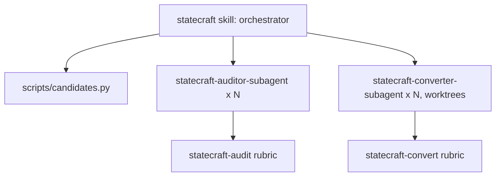

# Statecraft

Find the implicit state machines in any codebase and turn them into explicit, tested ones, without breaking behaviour
or contracts.

An implicit state machine is a lifecycle (something that loads, runs, waits, retries, fails, completes) held in
several fields instead of one: `isLoading` + `error` + `task`, `processed_at` + `failed_at` + `attempts`, a `status`
string compared against literals in ten files. Invalid combinations can be represented, transitions are scattered,
and the bugs show up as lost requests, stuck jobs, duplicated side effects and spinners that never stop.

Statecraft works for any language and stack, with backends as the main target: services, workers, queues,
databases, integrations, as well as CLIs, desktop and mobile apps and web clients. It is modelled on
[Thermos](https://github.com/cursor/plugins/tree/main/thermos): rubrics live in skills, thin subagents load them,
and an orchestrator fans out and merges.

## Install

```bash
claude plugin marketplace add rolottr/claude-mod-statecraft   # or a local path to this repository
claude plugin install statecraft@statecraft
```

## Use

| Ask | Mode | What happens |
| --- | --- | --- |
| "statecraft this branch" | diff | One auditor reviews the branch diff for new or extended implicit state, or code that bypasses an existing explicit machine. Report only. |
| "find all the implicit state machines in this service" | sweep | A candidate scan ranks files, auditors run in parallel per module, findings are merged into a catalogue with a recommended conversion order. Report only. |
| "statecraft and fix them" | fix | Converters run per machine in isolated worktrees, each behind the project's own quality gate; branches are merged one at a time. Never pushes, deploys or migrates non-local databases. |

## Architecture



| Component | Role |
| --- | --- |
| `skills/statecraft-audit` | Where implicit state hides (in memory, persisted rows, jobs, sagas, connections, clients), what is and is not a finding, reachability analysis, severity, output shape. |
| `skills/statecraft-convert` | How to make one machine explicit: per-language idioms, single transition owner, busy-request policy, stale-completion guard, atomic persisted transitions, expand/contract migrations, stable contracts, tests, quality gate. |
| `skills/statecraft` | Orchestrator for the diff, sweep and fix modes. |
| `skills/statecraft/scripts/candidates.py` | Standard-library heuristic that ranks files by lifecycle-like identifiers and lists status values compared in many files. |
| `agents/statecraft-auditor-subagent` | Read-only auditor for a diff or a shard. |
| `agents/statecraft-converter-subagent` | Converts the machines it is given, runs the gate, commits on its worktree branch. |

## Project conventions win

The rubrics read `AGENTS.md`, `CLAUDE.md`, `CONTRIBUTING.md` and the state types the codebase already has, and follow
them. Put your project's rule for lifecycles and its quality-gate command there; Statecraft will use both.

## Candidate scan

```bash
python3 -I skills/statecraft/scripts/candidates.py path/to/repo --top 40
```

## License

MIT
